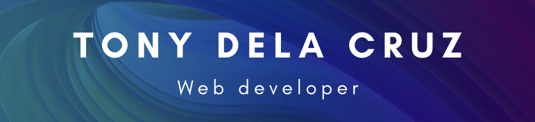

# Hi, I'm Tony

Engineering Lead building scalable full-stack web applications with TypeScript, Node.js, and Google Cloud.

I lead architecture and delivery across the stack — from responsive React and Next.js frontends to resilient Node.js and NestJS backend services on Google Cloud. I focus on shipping reliable, maintainable systems and elevating team engineering practices.

## Tech Stack

**Frontend:** TypeScript, React, Next.js, HTML/CSS

**Backend:** Node.js, NestJS, REST APIs, GraphQL

**Cloud & DevOps:** Google Cloud Platform, Docker, CI/CD

**Data:** PostgreSQL

## Current Focus

- Integrating AI/LLM capabilities into production web applications
- Cloud architecture and platform engineering on GCP
- Building portable AI-assisted developer workflows and tooling

## Get in Touch

- [LinkedIn](https://www.linkedin.com/in/tonymdc/)
